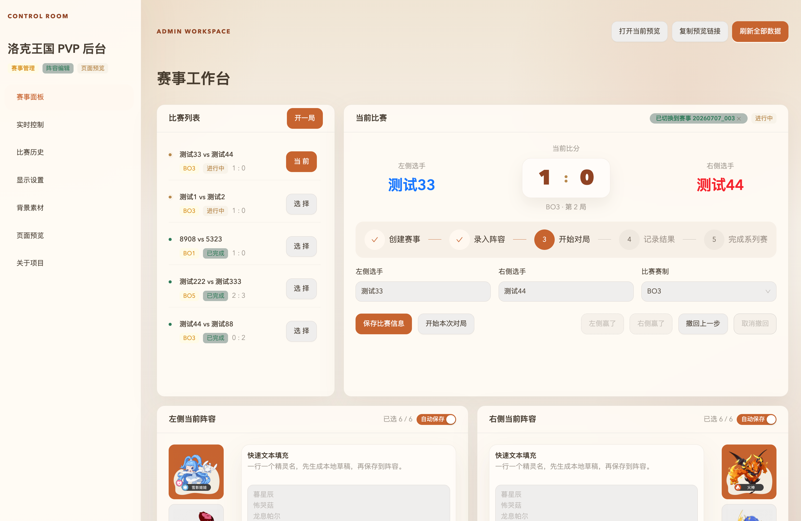
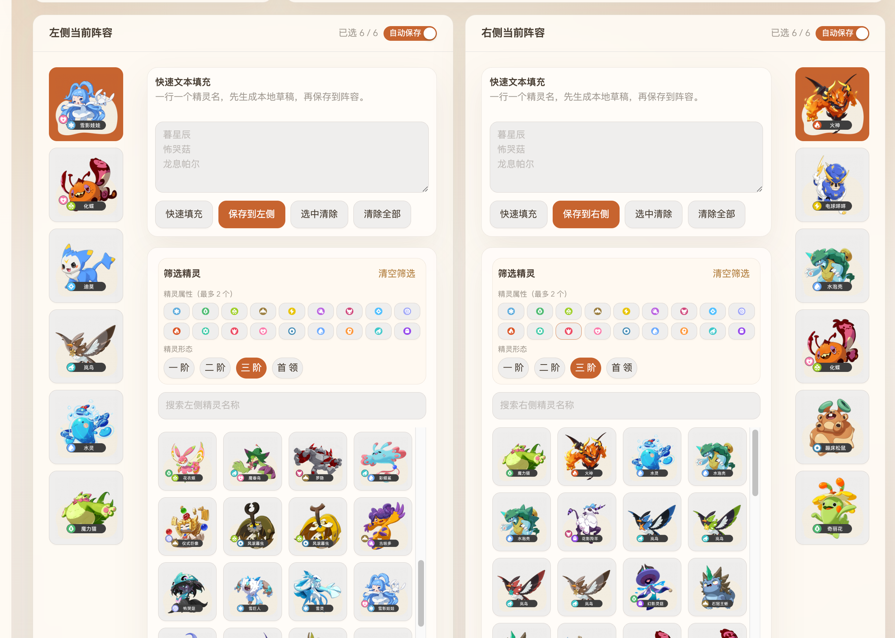
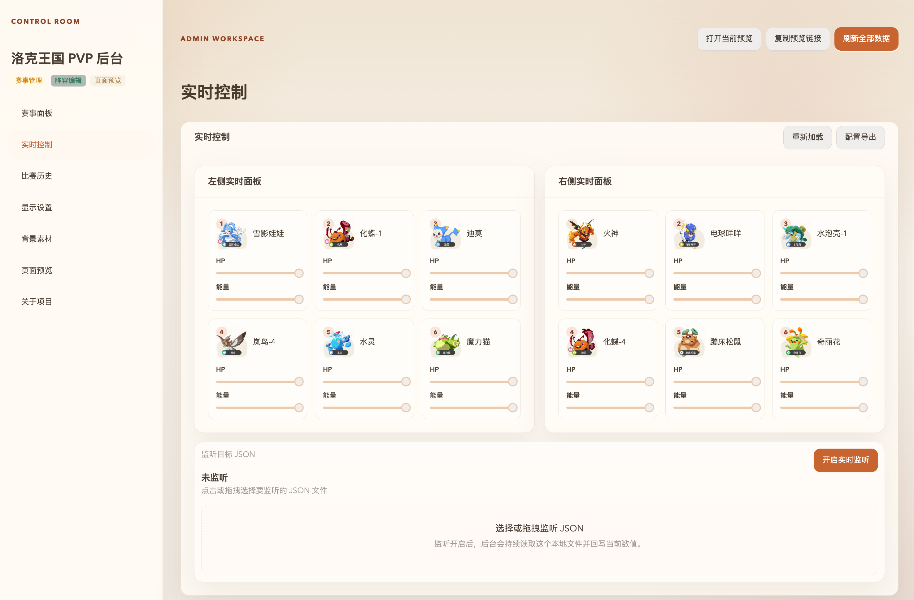
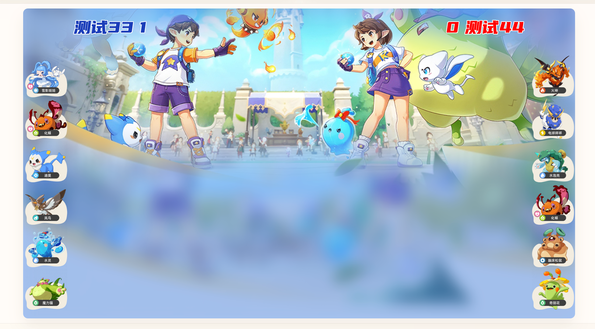
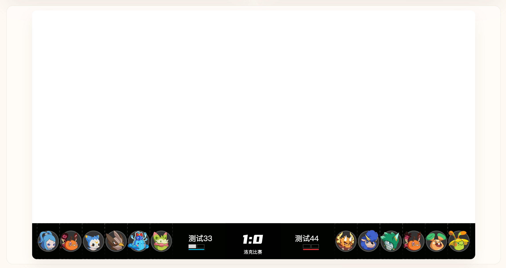
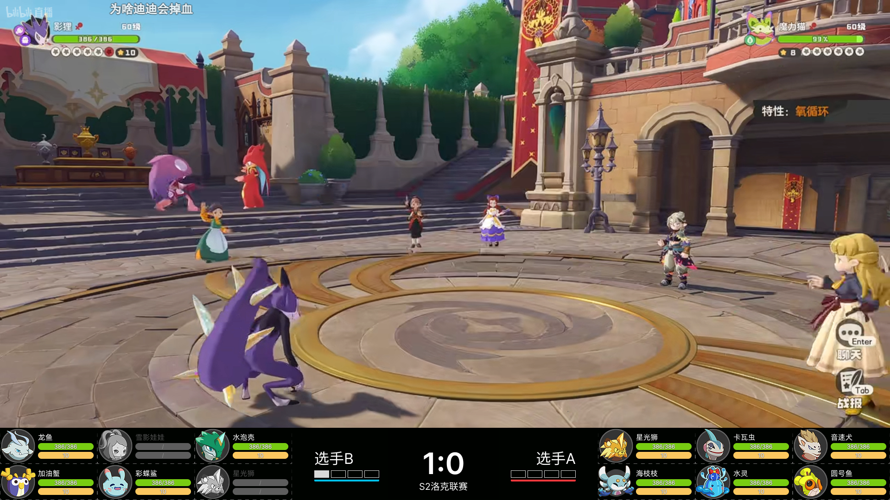
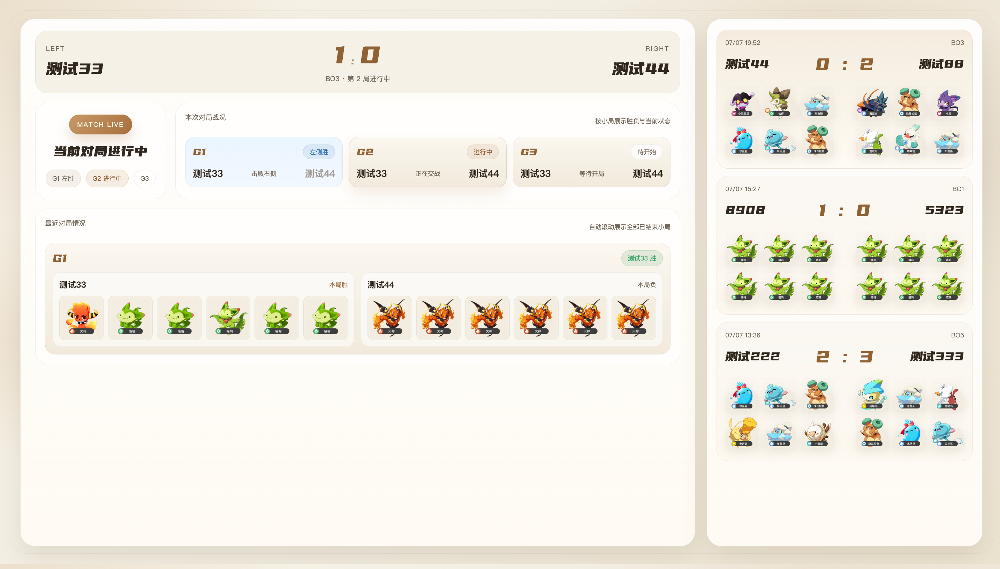
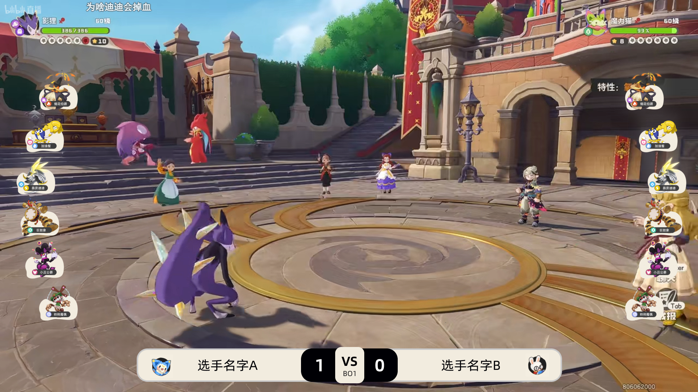

# 洛克王国世界阵容同步推流

洛克王国世界阵容同步推流 —— Electron（Express + Socket.IO）+ React/Ant Design 管理后台，用于赛事录入、阵容同步、比分控制、素材管理与推流页面预览。

## 作者与许可

- 作者邮箱：463218006@qq.com
- 本软件**免费开源使用**，基于 [MIT License](./LICENSE) 发布，可自由使用、复制、修改与分发（分发时需保留版权声明与许可声明）。

## 界面截图

### 管理后台

### 推流页面

常用命令：

- `npm run build:electron`
- `npm run dev`
- `npm run package`
